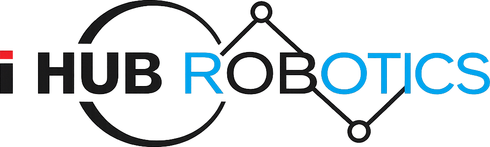
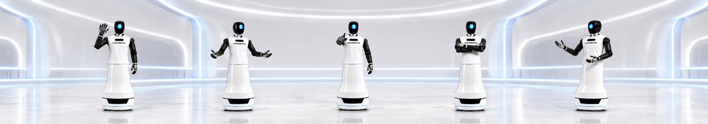
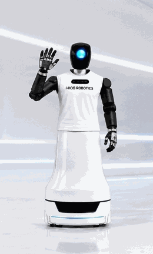
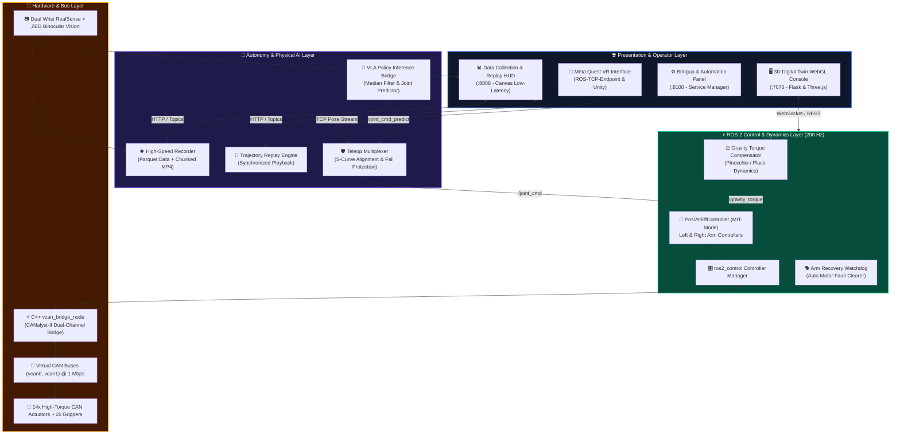

<p align="center">
  
</p>

<h1 align="center">🦾 Daksha: Enterprise Bimanual Humanoid Robot</h1>

<p align="center">
  <strong>High-Performance ROS 2 Dual-Arm Manipulation, Compliant MIT-Mode Control, VR Teleoperation & Physical AI Data Engine</strong>
</p>

<p align="center">
  <a href="https://docs.ros.org/en/humble/"></a>
  <a href="https://ubuntu.com/"></a>
  <a href="#controllers-topics-and-services"></a>
  <a href="#can-setup"></a>
  <a href="#data-collection-and-replay"></a>
  <a href="#license"></a>
</p>

<p align="center">
  
</p>

---

## 📑 Table of Contents

- [Overview & Visual Showcase](#-overview--visual-showcase)
- [Key Features](#-key-features)
- [System Architecture](#-system-architecture)
- [Hardware & Software Specifications](#-hardware--software-specifications)
- [Requirements](#requirements)
- [Installation](#installation)
- [Building](#building)
- [CAN Setup](#can-setup)
- [Running the Robot](#running-the-robot)
- [Controllers, Topics and Services](#controllers-topics-and-services)
  - [Controllers (200 Hz)](#controllers)
  - [Key Topics](#key-topics)
  - [Command Examples](#command-examples)
  - [`gen2` Nodes](#gen2-nodes)
  - [Services & Gain Presets](#services)
  - [Gravity Compensation](#gravity-compensation)
  - [Fault Recovery](#fault-recovery)
- [Teleoperation](#teleoperation)
  - [Leader–Follower Arms](#leaderfollower-arms)
  - [VR / Meta Quest](#vr--meta-quest)
  - [Perception & Cameras](#cameras)
- [Data Collection and Replay](#data-collection-and-replay)
  - [Demonstration Recording & Replay](#recording--replay)
  - [Teleop Multiplexer & Safety](#teleop-multiplexer-safety)
  - [Policy Inference Bridge (VLA)](#policy-inference-bridge)
- [Web Consoles & Operator Dashboard](#-web-consoles--operator-dashboard)
- [Running as a Systemd Service](#running-as-a-systemd-service)
- [Repository Layout](#repository-layout)
- [Troubleshooting Matrix](#troubleshooting-matrix)
- [License & Corporate Identity](#license--corporate-identity)

---

## 🌟 Overview & Visual Showcase

**Daksha** is an enterprise-grade bimanual humanoid robot developed by **iHub Robotics**. Engineered for next-generation physical artificial intelligence and dexterous manipulation, Daksha integrates dual 7-DoF arms, high-torque CAN actuators with real-time compliant impedance control, stereoscopic vision, multi-modal teleoperation (leader-follower & VR), and an autonomous dataset engine for Vision-Language-Action (VLA) imitation learning.

<table>
  <tr>
    <td width="35%" align="center">
      
      <br/>
      <em><b>Daksha in Action</b>: Compliant Bimanual Kinematics & Multi-Pose Articulation</em>
    </td>
    <td width="65%" valign="top">
      <h3>🚀 Engineering Capabilities at a Glance</h3>
      <ul>
        <li><b>14-DoF Dual Bimanual Arms</b>: 7-DoF left and right arms with single-finger grippers or multi-articulated hands.</li>
        <li><b>Compliant MIT-Mode Actuation</b>: 200 Hz real-time closed-loop position, velocity, and feed-forward torque control.</li>
        <li><b>Real-Time Gravity Compensation</b>: Dynamic model-based torque feed-forward computation using Pinocchio / Placo dynamics.</li>
        <li><b>Zero-G Hand Guiding (Teach Mode)</b>: Ultra-low impedance free-drive for intuitive demonstration learning.</li>
        <li><b>Multi-Modal Teleoperation</b>: Hardware leader arms (CAN/Serial/Wi-Fi) and Meta Quest VR tracking via ROS-TCP-Endpoint.</li>
        <li><b>Physical AI Pipeline</b>: Integrated Parquet + synchronized MP4 dataset collection compatible with Hugging Face LeRobot and OpenVLA.</li>
        <li><b>3D WebGL Digital Twin</b>: Operator telemetry dashboard, visual joint jogging, and camera feeds running directly in modern web browsers.</li>
      </ul>
    </td>
  </tr>
</table>

> Older, unedited operator notes from previous bring-ups live in [docs/NOTES.md](docs/NOTES.md). They reference other machines and sibling robots and are kept for history only.

---

## ⚡ Key Features

| Capability | Technical Description | Operational Benefit |
| :--- | :--- | :--- |
| **MIT-Mode Hybrid Control** | Per-joint $k_p$, $k_d$, and feed-forward torque ($\tau_{ff}$) computed at 200 Hz via `posveleff_controllers`. | Enables smooth contact transitions, compliant grasping, and safe human-robot coexistence. |
| **Active Gravity Compensation** | Live model calculation: $\tau = g(q) \cdot \text{dir} \cdot \text{scale}_{ff}$ tuned per individual joint. | Zero payload drag during manual teach-in and reduced motor thermal load. |
| **Zero-Drop Safety Multiplexer** | `teleop_mux` manages 4 safety states: `HOLD`, `MIMIC_ALIGN` (S-curve interpolation), `MIMIC`, and `REPLAY`. | Prevents jerks or sudden falls when engaging teleoperation or replaying trajectories. |
| **Dynamic CycloneDDS Discovery** | Subnet broadcast scanner auto-discovers network peers without static IP dependencies. | Flawless connectivity between robot base, compute unit, and operator laptops across reboots. |
| **Industrial Web Stack** | Native browser dashboards on ports `:7070` (3D twin), `:8888` (data recorder), and `:8100` (automation). | Zero client software setup; monitors telemetry, temperatures, and video from any workstation. |

---

## 🏗️ System Architecture

Daksha's software architecture provides seamless communication from low-level CAN bus registers up to cloud neural policies:



### Safety & Teleop State Machine

```mermaid
stateDiagram-v2
    [*] --> HOLD : System Bringup
    HOLD --> MIMIC_ALIGN : /teleop_mux/mimic Triggered
    note right of MIMIC_ALIGN : Smooth S-Curve trajectory smoothly aligns follower arms to current leader pose
    MIMIC_ALIGN --> MIMIC : Alignment Complete (Error < Threshold)
    MIMIC --> HOLD : Disconnect / Error / User Abort
    HOLD --> REPLAY : /replay/start Triggered
    REPLAY --> HOLD : Trajectory Finished / /replay/stop
```



---

## 📊 Hardware & Software Specifications

| Subsystem | Specification | Technical Details |
| :--- | :--- | :--- |
| **Arm Kinematics** | Dual 7-DoF anthropomorphic bimanual arms | Full spatial reach with spherical wrist articulation |
| **End Effectors** | 2x Single-finger compliant grippers / Bionic hands | Motor ID `8` per arm, CAN position/effort closed-loop |
| **Actuators** | High-density brushless CAN servo actuators | MIT-mode impedance control (`kp`, `kd`, `pos`, `vel`, $\tau$) |
| **CAN Interface** | Dual-channel CANalyst-II USB adapter | USB vendor `04d8:0053`, Bitrate `1,000,000 bps` |
| **Vision (Head)** | ZED stereo binocular camera system | Compressed color & rectified disparity depth feeds |
| **Vision (Wrists)** | Dual Intel RealSense RGB-D cameras | Left & right wrist visual feedback (`30 Hz`) |
| **Control Rate** | 200 Hz real-time hardware control loop | Low jitter via `ros2_control` hardware abstraction |
| **Compute & OS** | Ubuntu 22.04 LTS / ROS 2 Humble & Jazzy | CycloneDDS dynamic networking with real-time kernel support |

---

## Requirements

| Component | Version | Notes |
| :--- | :--- | :--- |
| **OS** | Ubuntu 22.04 LTS | Tested on x86_64 industrial workstations |
| **ROS 2** | Humble Hawksbill / Jazzy | Desktop or Base install |
| **Python** | 3.10+ | Required for Pinocchio / Placo / PyTorch bindings |
| **CAN Adapter** | CANalyst-II (USB `04d8:0053`) | Supports virtual interface bridging (`vcan0`, `vcan1`) |

Python dependencies are pinned in [src/requirements.txt](src/requirements.txt) (PyQt6, python-can, pinocchio, placo, pyarrow, Flask, OpenCV, …).

---

## Installation

### 1. Clone

```bash
git clone git@github.com:Baranidharan333/daksha.git ~/daksha
cd ~/daksha
```

### 2. Grant Access to the CAN Adapter

Without a udev rule the CANalyst-II device is root-only and the bridge fails to open it.

```bash
sudo tee /etc/udev/rules.d/99-canalyst.rules >/dev/null <<'EOF'
SUBSYSTEM=="usb", ATTR{idVendor}=="04d8", ATTR{idProduct}=="0053", MODE="0666"
EOF

sudo udevadm control --reload-rules
sudo udevadm trigger
```

*Unplug and re-insert the adapter afterwards.*

### 3. System Packages

```bash
sudo apt update
sudo apt install -y \
    python3-pip python3-dev python3-venv python3-setuptools python3-wheel \
    python3-packaging build-essential cmake ninja-build git pkg-config \
    libgl1 libglib2.0-0 libxcb-xinerama0 libxkbcommon-x11-0 libegl1 \
    libdbus-1-3 libfontconfig1 qt6-base-dev \
    ros-humble-joint-state-publisher-gui ros-humble-topic-tools nmap
```

### 4. Python Packages

```bash
python3 -m pip install --user --upgrade \
    pip setuptools==79.0.1 wheel packaging sip pyqt6-sip

export PATH=$HOME/.local/bin:$PATH

python3 -m pip install --user --no-build-isolation -r src/requirements.txt
python3 -m pip install --user canalystii "python-can[canalystii]"
```

> `--no-build-isolation` is required: `placo` and `pin` build against the system-installed Eigen/Boost headers.

---

## Building

```bash
cd ~/daksha
source /opt/ros/humble/setup.bash
colcon build --symlink-install
source install/setup.bash
```

Build a single package while iterating:

```bash
colcon build --packages-select hw_interface
```

Clean rebuild:

```bash
rm -rf build install log && colcon build
```

---

## CAN Setup

The hardware interface talks to two virtual CAN buses (`vcan0`, `vcan1`) that a bridge process forwards to the physical CANalyst-II adapter.

```bash
sudo modprobe vcan

sudo ip link add dev vcan0 type vcan
sudo ip link add dev vcan1 type vcan
sudo ip link set up vcan0
sudo ip link set up vcan1
```

[src/scripts/can_up.sh](src/scripts/can_up.sh) performs the same steps automatically.

The bridge is started automatically by `bringup.launch.py`. Run it standalone with either implementation — **only one may run at a time**, since both claim the same USB device and virtual interfaces:

```bash
# C++ (default, from hw_interface)
ros2 run hw_interface vcan_bridge_node

# Python equivalent
python3 src/scripts/vcan_bridge.py
```

For a directly attached (non-virtual) adapter:

```bash
sudo ip link set can0 down
sudo ip link set can0 type can bitrate 1000000
sudo ip link set can0 up
```

---

## Running the Robot

Full bring-up — CAN bridge, `controller_manager`, `robot_state_publisher`, controller spawners, gravity compensation, gesture management, diagnostics, logging, and the operator UI:

```bash
source /opt/ros/humble/setup.bash
source ~/daksha/install/setup.bash

ros2 launch gen2 bringup.launch.py
```

### Launch Arguments

| Argument | Default | Description |
| :--- | :--- | :--- |
| `use_cpp_vcan_bridge` | `true` | Use the C++ `hw_interface/vcan_bridge_node` instead of the Python `gen2/vcan_bridge` node. |

### Manual Bring-Up

Useful when testing a single URDF or controller configuration:

```bash
URDF=$(ros2 pkg prefix daksha_description_full_body)/share/daksha_description_full_body/urdf/robot.urdf

ros2 run controller_manager ros2_control_node \
  --ros-args \
  --params-file src/gen2/config/controllers.yaml \
  -p robot_description:="$(cat $URDF)"

ros2 run robot_state_publisher robot_state_publisher \
  --ros-args -p robot_description:="$(cat $URDF)"
```

Then load and activate the controllers:

```bash
ros2 control load_controller --set-state active joint_state_broadcaster && \
ros2 control load_controller --set-state active left_arm_mit_controller && \
ros2 control load_controller --set-state active right_arm_mit_controller && \
ros2 control load_controller --set-state active left_gripper_mit_controller && \
ros2 control load_controller --set-state active right_gripper_mit_controller
```

Inspect state:

```bash
ros2 control list_hardware_components
ros2 control list_controllers
```

---

## Controllers, Topics and Services

### Controllers

Defined in [src/gen2/config/controllers.yaml](src/gen2/config/controllers.yaml), running at **200 Hz**.

| Controller | Type | Joints |
| :--- | :--- | :--- |
| `joint_state_broadcaster` | `joint_state_broadcaster/JointStateBroadcaster` | all |
| `left_arm_mit_controller` | `posveleff_controllers/PosVelEffController` | `left_joint_1` … `left_joint_7` |
| `right_arm_mit_controller` | `posveleff_controllers/PosVelEffController` | `right_joint_1` … `right_joint_7` |
| `left_gripper_mit_controller` | `posveleff_controllers/PosVelEffController` | `left_gripper_left_joint` |
| `right_gripper_mit_controller` | `posveleff_controllers/PosVelEffController` | `right_gripper_right_joint` |

### Key Topics

| Topic | Type | Description |
| :--- | :--- | :--- |
| `/joint_cmd` | `sensor_msgs/JointState` | Primary command entry point; accepts partial joint name lists. |
| `/jnt_cmt_to_ctrl` | `sensor_msgs/JointState` | Fully populated command forwarded to the controllers. |
| `/joint_states` | `sensor_msgs/JointState` | Measured state from the broadcaster. |
| `/<controller>/joint_trajectory` | `trajectory_msgs/JointTrajectory` | Per-controller trajectory input. |
| `/<Arm>System_ordered_joint_states` | `sensor_msgs/JointState` | Per-arm measured state in motor order. |
| `/gravity_torque` | `sensor_msgs/JointState` | Computed gravity feed-forward effort. |
| `/joint_cmd_predict` | `sensor_msgs/JointState` | Policy predictions, filtered by `vla_bridge`. |

### Command Examples

Command a single gripper (open / close):

```bash
ros2 topic pub -1 /joint_cmd sensor_msgs/msg/JointState \
  "{name: ['right_gripper_right_joint'], position: [-0.044]}"   # close

ros2 topic pub -1 /joint_cmd sensor_msgs/msg/JointState \
  "{name: ['right_gripper_right_joint'], position: [0.0]}"      # open
```

Send an arm trajectory:

```bash
ros2 topic pub --once /left_arm_mit_controller/joint_trajectory \
  trajectory_msgs/msg/JointTrajectory "
joint_names: [left_joint_1, left_joint_2, left_joint_3, left_joint_4,
              left_joint_5, left_joint_6, left_joint_7]
points:
- positions: [0.2, 0.0, 0.0, 0.0, 0.0, 0.0, 0.0]
  velocities: [0.0, 0.0, 0.0, 0.0, 0.0, 0.0, 0.0]
  effort: [0.0, 0.0, 0.0, 0.0, 0.0, 0.0, 0.0]
  time_from_start: {sec: 2}
"
```

Drive the arms from a GUI:

```bash
ros2 run joint_state_publisher_gui joint_state_publisher_gui \
  --ros-args -r /joint_states:=/joint_cmd
```

### `gen2` Nodes

| Executable | Purpose |
| :--- | :--- |
| `vcan_bridge` | Python CAN bridge (alternative to the C++ `hw_interface` node). |
| `joint_cmd` | Fans `/joint_cmd` out to the per-arm controllers. |
| `GravityToJointCmd` | Injects gravity feed-forward effort into commands. |
| `joint_cmd_publisher_from_joint_sates` | Echoes measured state back as commands. |
| `teach_mode_node` | Free-drive / teach mode. |
| `mode_toggler` | Switch between teach and control modes. |
| `gravity_scale_setter` | Apply the tuned per-joint `ff_scale` preset. |
| `gravity_ff_tuner` | Interactive feed-forward tuning. |
| `HomeMoveService` | Provides `/move_home`. |
| `arm_recovery_watchdog` | Auto-recovers arms after a motor fault. |
| `battery_info` | Battery telemetry. |
| `leader_controller_ui` | Leader-arm control panel. |
| `joint_cmd_web_ui` | Browser-based joint jogging. |

### Services

| Service | Type | Purpose |
| :--- | :--- | :--- |
| `/<Arm>System/set_motor_gains` | `hw_interface/srv/SetMotorGains` | Set per-motor `kp`/`kd`. |
| `/<Arm>System/arm_recover` | `std_srvs/srv/Trigger` | Clear motor faults and re-enable the arm. |
| `/move_home` | `std_srvs/srv/Trigger` | Move both arms to the home pose. |

*`<Arm>` is `LeftArm` or `RightArm`, matching the hardware component names in [controllers.yaml](src/gen2/config/controllers.yaml).*

#### Gain Presets

The MIT-mode impedance controller computes:

$$\tau_i = \tau_{ff, i} + k_p (q_{cmd, i} - q_{meas, i}) + k_d (\dot{q}_{cmd, i} - \dot{q}_{meas, i})$$

Gains are the main tuning knob and differ sharply between modes. Motor IDs `1–7` are the arm joints; `8` is the gripper.

```bash
# Stiff — normal operation / holding payload
ros2 service call /LeftArmSystem/set_motor_gains hw_interface/srv/SetMotorGains \
"motor_ids: [1,2,3,4,5,6,7,8]
kp: [100.0,100.0,70.0,70.0,30.0,30.0,30.0,10.0]
kd: [5.0,5.0,4.0,4.0,2.0,2.0,2.0,1.0]"

# Medium — VLA / policy inference
ros2 service call /LeftArmSystem/set_motor_gains hw_interface/srv/SetMotorGains \
"motor_ids: [1,2,3,4,5,6,7,8]
kp: [40.0,40.0,25.0,25.0,10.0,10.0,10.0,2.5]
kd: [2.0,2.0,1.5,1.5,0.5,0.5,0.5,0.25]"

# Near-zero — teach mode / free-drive
ros2 service call /LeftArmSystem/set_motor_gains hw_interface/srv/SetMotorGains \
"motor_ids: [1,2,3,4,5,6,7,8]
kp: [0.05,0.05,0.05,0.05,0.05,0.05,0.05,1.0]
kd: [0.01,0.01,0.01,0.01,0.01,0.01,0.01,0.3]"
```

*Apply the same call to `/RightArmSystem/set_motor_gains` for the other arm.*

### Gravity Compensation

`gravity_torque_node` (from the `dynamics` package) computes:

$$\tau_{grav} = g(q) \cdot \text{direction} \cdot \text{scale}_{ff}$$

and publishes it on `/gravity_torque`. The per-joint feed-forward scale is a live-tunable parameter:

```bash
ros2 param set /gravity_torque_node ff_scale.left_joint_1 0.22
ros2 param get /gravity_torque_node ff_scale.left_joint_1
```

`gen2/gravity_scale_setter` applies the full tuned preset for all 14 arm joints in one pass and is started by the bring-up launch:

```bash
ros2 run gen2 gravity_scale_setter
```

### Fault Recovery

```bash
ros2 service call /LeftArmSystem/arm_recover std_srvs/srv/Trigger "{}"
ros2 service call /RightArmSystem/arm_recover std_srvs/srv/Trigger "{}"
```

---

## Teleoperation

### Leader–Follower Arms

```bash
ros2 launch gen2_leader gen2_leader.launch.py           # leader arms
ros2 launch gen2_leader gen2_leader_mirror.launch.py    # mirrored mapping
```

Individual nodes from the `gen2_leader` package:

| Executable | Purpose |
| :--- | :--- |
| `leader_raw` | Raw leader-arm reader over CAN. |
| `leader_serial` | Raw leader-arm reader over serial. |
| `leader_wifi` | Leader with trigger services over Wi-Fi. |
| `leader_mirror` | Mirrored leader-follower mapping over Wi-Fi. |
| `leader_torque_toggle` | Toggle torque on the leader arms. |

### VR / Meta Quest

```bash
ros2 run ros_tcp_endpoint default_server_endpoint
python3 src/scripts/quest_bridge.py
python3 src/scripts/vr_pose_relay.py
```

### Cameras

```bash
ros2 launch world_camera_launch start_all_cameras.launch.py   # all RealSense units
ros2 launch world_camera_launch world_camera.launch.py        # world camera only
```

Camera topics consumed by the recorder and the UI:

| Name | Topic | Frame Rate |
| :--- | :--- | :--- |
| **Left Wrist** | `/left/camera/color/image_raw/compressed` | 30 FPS |
| **Right Wrist** | `/right/camera/color/image_raw/compressed` | 30 FPS |
| **Binocular (Left)** | `/zed/zed_node/left/color/rect/image/compressed` | 30/60 FPS |
| **Binocular (Right)** | `/zed/zed_node/right/color/rect/image/compressed` | 30/60 FPS |

---

## Data Collection and Replay

The `daksha_data_collection` package records joint states and camera streams to Parquet plus chunked MP4, and replays them back onto the robot. It ships a web UI alongside the terminal interface — see its own [README](src/ui/Clients_UI/daksha_data_collection/README.md) for the UI and the CycloneDDS peer-discovery setup.

```bash
ros2 launch daksha_data_collection data_collection.launch.py
```

### Recording & Replay

Recording:

```bash
ros2 service call /recorder/start daksha_msgs/srv/StartRecord \
  "{dataset_name: 'terminal_demo', episode_length: 200, record_hz: 20.0, max_episodes: 1}"

ros2 service call /recorder/stop std_srvs/srv/Trigger
```

Replay:

```bash
ros2 service call /replay/start daksha_msgs/srv/StartReplay \
  "{dataset_name: 'terminal_demo', episode_index: 0, speed: 1.0}"

ros2 service call /replay/stop std_srvs/srv/Trigger
```

### Teleop Multiplexer & Safety

Teleop multiplexer (safety and leader-follower alignment):

```bash
ros2 service call /teleop_mux/mimic std_srvs/srv/Trigger   # follow the leader
ros2 service call /teleop_mux/hold  std_srvs/srv/Trigger   # hold position
```

Progress is published on `/recorder/ui_status` and `/replay/ui_status`.

> `src/custom_v3format_dataset/` is an earlier standalone recorder. Only compiled `.pyc` files remain in the tree — the sources are not checked in, so use `daksha_data_collection` instead. The historical CLI invocations are preserved in [docs/NOTES.md](docs/NOTES.md).

### Policy Inference Bridge

[src/scripts/vla_bridge.py](src/scripts/vla_bridge.py) filters policy output before it reaches the arms: it reads predictions on `/joint_cmd_predict`, median-filters them, and republishes to `/joint_cmd`. Each arm can be locked independently so a policy drives one arm while the other holds.

```bash
python3 src/scripts/vla_bridge.py

ros2 service call /left_arm_trigger_handler  std_srvs/srv/Trigger "{}"
ros2 service call /right_arm_trigger_handler std_srvs/srv/Trigger "{}"
```

| Topic | Direction | Description |
| :--- | :--- | :--- |
| `/joint_cmd_predict` | in | Raw policy predictions. |
| `/LeftArmSystem_ordered_joint_states` | in | Measured left-arm state. |
| `/RightArmSystem_ordered_joint_states` | in | Measured right-arm state. |
| `/joint_cmd` | out | Filtered command to the robot. |

The policy server itself lives outside this repository. The validation UI expects an Isaac-GR00T virtual environment; its path is configurable via `VENV` in [src/ui/Clients_UI/validation/run_validation_ui.sh](src/ui/Clients_UI/validation/run_validation_ui.sh).

---

## 🌐 Web Consoles & Operator Dashboard

Access Daksha's unified web platform directly from any web browser on your network:

| Interface | URL | Module | Capabilities |
| :--- | :--- | :--- | :--- |
| **3D Digital Twin Dashboard** | `http://<ROBOT_IP>:7070` | `daksha_ui` | Real-time Three.js 3D URDF visualization, joint angle telemetry, motor temperatures, emergency stop. |
| **Data Collection HUD** | `http://<ROBOT_IP>:8888` | `daksha_data_collection` | Low-latency 4-cam canvas stream, record/replay trigger, dataset metadata tagging, smooth safety alignment. |
| **Process Automation Console** | `http://<ROBOT_IP>:8100` | `automation` | Web process monitor, ROS node lifecycle manager, single-click bringup/shutdown, real-time log streaming. |

---

## Running as a Systemd Service

To bring the robot up automatically on boot:

```bash
sudo tee /etc/systemd/system/gen2.service >/dev/null <<'EOF'
[Unit]
Description=Gen2 Robot Bringup
After=network-online.target
Wants=network-online.target

[Service]
Type=simple
User=ihub
WorkingDirectory=/home/ihub/daksha_ws/daksha

Environment=HOME=/home/ihub
Environment=VCAN_SUDO_PASSWORD=1234

ExecStart=/bin/bash -c 'source /opt/ros/humble/setup.bash && source /home/ihub/daksha_ws/daksha/install/setup.bash && ros2 launch gen2 bringup.launch.py'

Restart=always
RestartSec=5

[Install]
WantedBy=multi-user.target
EOF

sudo systemctl daemon-reload
sudo systemctl enable --now gen2.service
```

Adjust `User` and the paths to match the target machine. `VCAN_SUDO_PASSWORD` is used by the bridge to create the virtual CAN interfaces at startup — replace the placeholder with the real password, and prefer a passwordless sudoers rule for `ip link` over storing a password in the unit file.

Monitor:

```bash
sudo systemctl status gen2.service
journalctl -u gen2.service -f
```

---

## Repository Layout

```
daksha/
├── docs/                                  # Documentation and media assets
│   ├── assets/                            # Logos, banners, diagrams, and animations
│   │   ├── ihub_logo.png                  # Corporate transparent logo
│   │   ├── daksha_banner.png              # Multi-pose widescreen studio panorama
│   │   ├── daksha_gestures.gif            # Looping animation of Daksha gesturing
│   │   └── daksha_robot.png               # High-res robot portrait
│   └── NOTES.md                           # Historical bringup notes and hardware logs
├── src/
│   ├── gen2/                              # Bring-up launch, joint_cmd, teach mode, gravity scaling
│   ├── controllers/
│   │   ├── hw_interface/                  # ros2_control hardware interface + C++ CAN bridge
│   │   ├── posveleff_controllers/         # MIT-mode position/velocity/effort controller (200 Hz)
│   │   ├── dynamics/                      # Gravity torque computation solvers
│   │   ├── kinematics/                    # Forward and inverse kinematics engines
│   │   ├── collision_management/          # Self-collision checks & safety stops
│   │   └── moveit_collision_management/   # MoveIt 2 collision scene integration
│   ├── daksha_description_full_body/      # URDF, meshes, Placo IK sim
│   ├── tele/
│   │   ├── gen2_leader/                   # Leader-arm teleoperation (CAN/Serial/WiFi)
│   │   ├── vr_teleop/                     # VR pose relay and management UI
│   │   └── ROS-TCP-Endpoint/              # Unity/Quest bridge
│   ├── ui/
│   │   ├── Clients_UI/
│   │   │   ├── daksha_ui/                 # Operator 3D WebGL UI (port 7070)
│   │   │   ├── daksha_data_collection/    # Recorder, replay and data management HUD (port 8888)
│   │   │   ├── daksha_msgs/               # StartRecord / StartReplay interfaces
│   │   │   └── daksha_final_urdf_description/
│   │   └── analyzer/                      # joint_analyzer & plot server
│   ├── gesture_management/                # Record, save and replay gesture sequences
│   ├── global/                            # API bridges (leader / follower)
│   ├── diagnosis/                         # vajara diagnostics, temp graphs
│   ├── joint_cmd_logger/                  # CSV logging of /joint_cmd and /jnt_cmt_to_ctrl
│   ├── automation/                        # Web panel to launch/kill bring-up (port 8100)
│   ├── navigation/                        # Web navigation site & AMR base
│   ├── world_camera_launch/               # World camera launch files
│   ├── custom_v3format_dataset/           # Legacy recorder (compiled artifacts only)
│   ├── scripts/                           # Standalone bridges and utilities
│   └── requirements.txt                   # Pinned Python package dependencies
└── readme.md                              # This file
```

---

## Troubleshooting Matrix

| Symptom | Probable Cause | Verification & Resolution |
| :--- | :--- | :--- |
| **CAN device is not accessible** | Missing udev rule or adapter replug required. | Confirm the udev rule is installed: `lsusb \| grep 04d8`. If the adapter product ID is `1234` instead of `0053`, adjust `/etc/udev/rules.d/99-canalyst.rules` and reload. |
| **Bridge starts but no motor feedback** | Two bridge processes competing for USB. | The C++ and Python bridges both claim the same USB device and `vcan0`/`vcan1`. Stop one, or pass `use_cpp_vcan_bridge:=false`. |
| **Arm does not move after a fault** | Fault clearing resets motor gains to zero. | Call `arm_recover` on that arm, then immediately re-apply the gain preset via `set_motor_gains`. |
| **Arm is limp or oscillating** | Incorrect gain preset for active mode. | Near-zero gains are for teach mode only. Re-apply the stiff or medium preset before commanding trajectories. |
| **Controllers fail to spawn** | `robot_description` was not loaded. | Inspect with `ros2 control list_hardware_components`. An unreadable URDF path leaves the controller manager running with no hardware. |
| **Simulated joint visualization** | Testing without physical hardware. | Relay commands directly to states: `ros2 run topic_tools relay /joint_cmd /joint_states`. |

---

## License & Corporate Identity

This project is licensed under the **Apache License 2.0** — see [src/gen2/LICENSE](src/gen2/LICENSE) for details.

Developed with ❤️ by the robotics team at **iHub Robotics**.  
*For industrial deployments, commercial inquiries, or academic research collaborations, please visit or reach out to the iHub Robotics team.*
